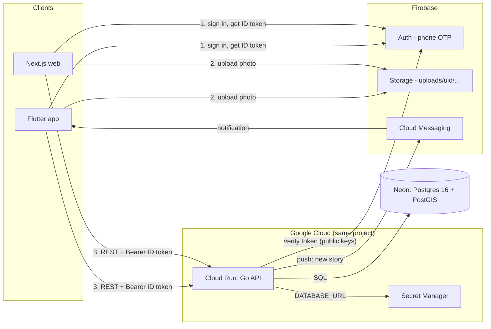

# Memopin Platform: Go Backend, Postgres, Web — Design

Date: 2026-10-17. Status: draft, awaiting review.

## Intent

Today the Flutter app (`apps/mobile`) talks to Firestore directly from ~30 call sites; there is no server. Business rules (nearest-place lookup, "timeline visible only to followers", follower counts, new-story notifications) run on the client, so they are unenforceable and duplicated per platform. A web client would have to re-implement all of it.

Goal: move data and business rules into a self-built Go API on Postgres, keep Firebase only where it is the better tool, and add a web client that uses the same API.

## Goals

1. `backend/` — Go HTTP API + Postgres owns `users`, `locations`, `stories`, `follows`, and device tokens. All rules enforced server-side.
2. Mobile app reads/writes only through the API (no `cloud_firestore`).
3. `apps/web/` — Next.js client: public place/story pages + signed-in features (follow, post story, profile).
4. Real push notifications (FCM) sent by the backend when a followed user posts, replacing the in-app Firestore listeners in `lib/main.dart`.
5. Seed command loads places (`locations`) into Postgres. There are no real users, so users/stories/follows are not migrated.
6. API runs on Cloud Run (`asia-southeast1`) in the same GCP project as Firebase. Postgres 16 + PostGIS: local Docker during development, Neon free plan (Singapore) once deployed, Cloud SQL considered at launch. Setup: `docs/setup/firebase-gcp.md`.

## Non-goals

- Replacing Firebase Auth. Phone OTP stays on Firebase; the backend only verifies ID tokens.
- Replacing Firebase Storage. Clients upload images directly; the backend stores the URL.
- Realtime streams. Lists become request/refresh; push covers "something new happened".
- In-app routing (directions still open an external maps app).

## Anti-goals (failure even if it "works")

- Backend trusts a client-supplied uid. Identity comes only from the verified Firebase ID token.
- A story can point at an arbitrary image URL (must be our bucket, uploader's own folder).
- Follow-gated timelines leak through any endpoint.
- A service account key file exists anywhere (laptop, repo, CI). Cloud Run uses the attached service account; local dev uses `gcloud auth application-default login`.

## Firebase: what stays, what goes

| Firebase product | Decision | Why |
|---|---|---|
| Auth (phone OTP) | **Keep** | SMS/OTP + reCAPTCHA is hard to rebuild; backend verifies ID tokens with Admin SDK |
| Storage | **Keep** | Direct client upload, no image traffic through API |
| Cloud Messaging (FCM) | **Add** | Real push for new stories, sent from backend |
| Firestore | **Not created** in the new project | Replaced by Postgres |

A **new** Firebase project replaces `exploreapp-eda90` (no real users to keep). The Firebase project is also the GCP project for Cloud Run, so IAM stays in one place.

## Architecture

Image bytes never pass through the API: the client uploads to Storage, then sends the download URL in the API call.

- **Go**: chi v5 router, pgx v5, sqlc for queries, goose for migrations (embedded), firebase-admin-go v4 (auth + messaging), slog, testcontainers-go for integration tests.
- **Postgres 16 + PostGIS**: nearest-place lookup (`<->` on `geography`), and future "near me".
- **Web**: Next.js (App Router, TypeScript), Tailwind, Firebase JS SDK for phone auth, react-leaflet with the same tile config as mobile. Chosen over Flutter web for SEO on public place/story pages.

## Data model

Postgres replaces the four Firestore collections (field mapping kept below for reference). `locations.seed_key` makes the seed command idempotent; user ids are the Firebase uid.

| Table | Key columns | From Firestore |
|---|---|---|
| `users` | `id` (Firebase uid), `display_name`, `photo_url`, `phone` | `users` (`displayName`, `photoURL`) |
| `locations` | `id` uuid, `seed_key`, `venue_name`, `venue_location`, `description`, `image_url`, `geog` | `locations` (`venueName`, `venueLocation`, `description`, `imagePath`, `latN`, `longE`) |
| `stories` | `id` uuid, `owner_id`, `location_id`, `title`, `type`, `description`, `image_url`, `created_at` | `stories` (`owner`, `locationId`, `storyTitle`, `storyType`, `storyDescription`, `storyImage`, `storyTime`) |
| `follows` | PK (`follower_id`, `target_id`), no self-follow | `follow` (`follower`, `target`) |
| `devices` | `token` PK, `user_id`, `platform` | new |

## API surface (v1)

All JSON, camelCase. Errors: `{"error":{"code":"...","message":"..."}}`.

| Method + path | Auth | Replaces |
|---|---|---|
| `GET /v1/me` | required | `userExisted` + `createUserPublicProfile` (upserts profile on first call) |
| `PATCH /v1/me` | required | `updateDisplayName`, `updatePhoto` |
| `GET /v1/locations?q=&limit=&offset=` | none | Explore list + search, story counts |
| `GET /v1/locations/{id}` | none | details page |
| `GET /v1/locations/{id}/stories?cursor=&limit=` | none | "Local stories" |
| `GET /v1/users?q=&limit=&offset=` | none | People tab (sorted by followers) |
| `GET /v1/users/{id}` | required | public profile + `isFollowing` |
| `GET /v1/users/{id}/stories` | required, self or follower | user timeline |
| `PUT` / `DELETE /v1/users/{id}/follow` | required | follow / unfollow |
| `POST /v1/stories` | required | create story; server picks nearest place |
| `POST /v1/me/devices`, `DELETE /v1/me/devices/{token}` | required | FCM token registry |

## Phases

| Phase | Deliverable | Plan |
|---|---|---|
| 0 | New Firebase/GCP project (user, by hand) | `docs/setup/firebase-gcp.md` |
| 1 | Go backend + Postgres + FCM + locations seed, deployed to Cloud Run | `docs/superpowers/plans/2026-10-17-go-backend.md` |
| 2 | Mobile: new app id + `flutterfire configure`, switch to API, add `firebase_messaging`, drop `cloud_firestore` and local listeners | separate plan, after Phase 1 |
| 3 | `apps/web` Next.js client | separate plan, after Phase 1 |
| 4 | New features (below), one plan each | later |

No cutover phase: no real users, so the mobile app simply points at the new project in Phase 2.

Phases 2 and 3 can run in parallel once Phase 1 is deployed.

## Proposed new features (ranked)

**Social core**
1. Following feed: tab showing newest stories from people you follow.
2. Likes and comments on stories.
3. Edit / delete own story.

**Discovery**
4. "Near me": places sorted by distance (PostGIS already in place).
5. Choose the place when posting (nearest is pre-selected, user can change). Fixes wrong auto-assignment.
6. Shareable web links for places/stories with Open Graph preview.

**Safety and operations**
7. Report story / block user. Required by App Store and Play policy for user-generated content.
8. Admin web: CRUD places, review reports. Today places are only seeded by hand in Firestore.

## Decisions made without user input (review these)

- Web stack is Next.js, not Flutter web (SEO for public pages).
- No realtime: lists refresh on pull / navigation; push notifies new stories.
- Notifications are fire-and-forget after the story commits (no outbox). A crash between commit and send loses that push. Acceptable at this scale.
- New uploads go to `uploads/{uid}/...` in Storage; backend rejects story/profile image URLs outside our bucket or outside the caller's folder. Imported legacy URLs are kept as-is.
- Story creation keeps today's rule: nearest place wins, no max distance. If no places exist → 422.
- Neon: direct (non-pooled) connection string with `sslmode=verify-full&pool_max_conns=5`; the API keeps its own pgx pool.
- App id changes from `com.memopin.app` to a real one before registering apps in the new project (Play Store rejects `com.example.*`).

## Decided by user

- Hosting: Google Cloud (Cloud Run) for the API.
- Postgres: local Docker now, Neon free plan when deployed; no Cloud SQL until launch.
- New Firebase project; no real users, so no data migration besides places.

## Firebase / GCP console work (user)

Step-by-step in `docs/setup/firebase-gcp.md`: create project + Blaze, phone auth with test numbers, register apps via `flutterfire configure`, Storage bucket + rules, APNs key, Neon + secret + service account.
